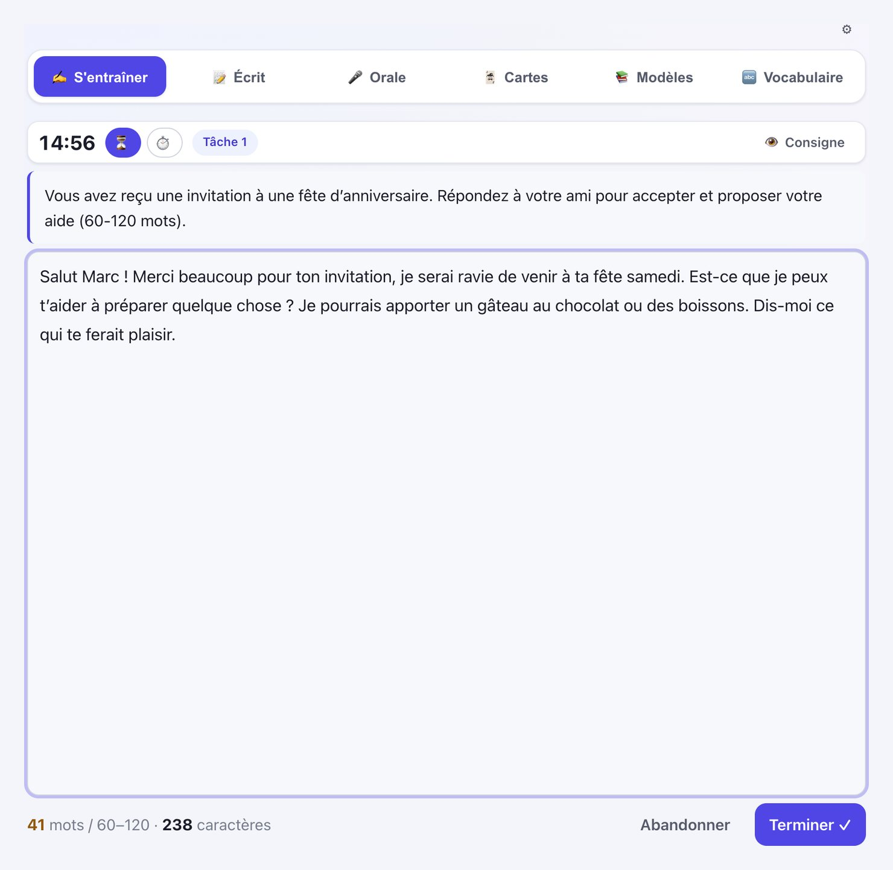
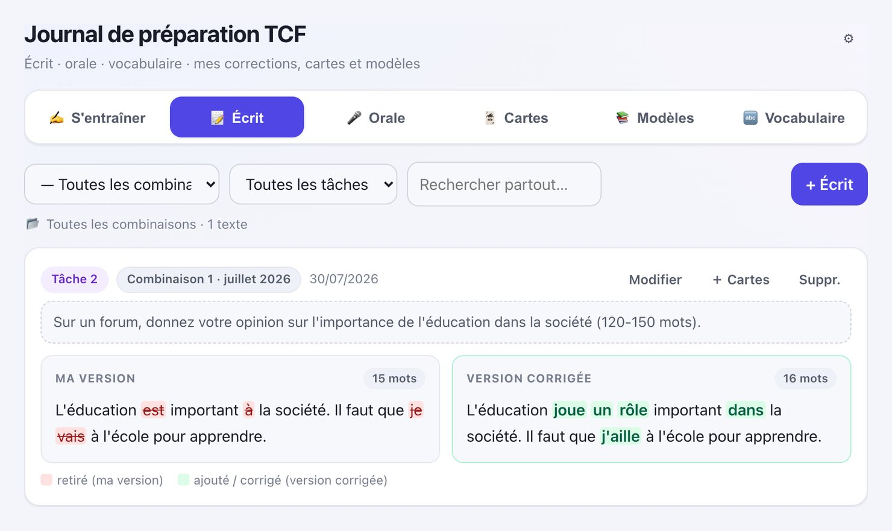
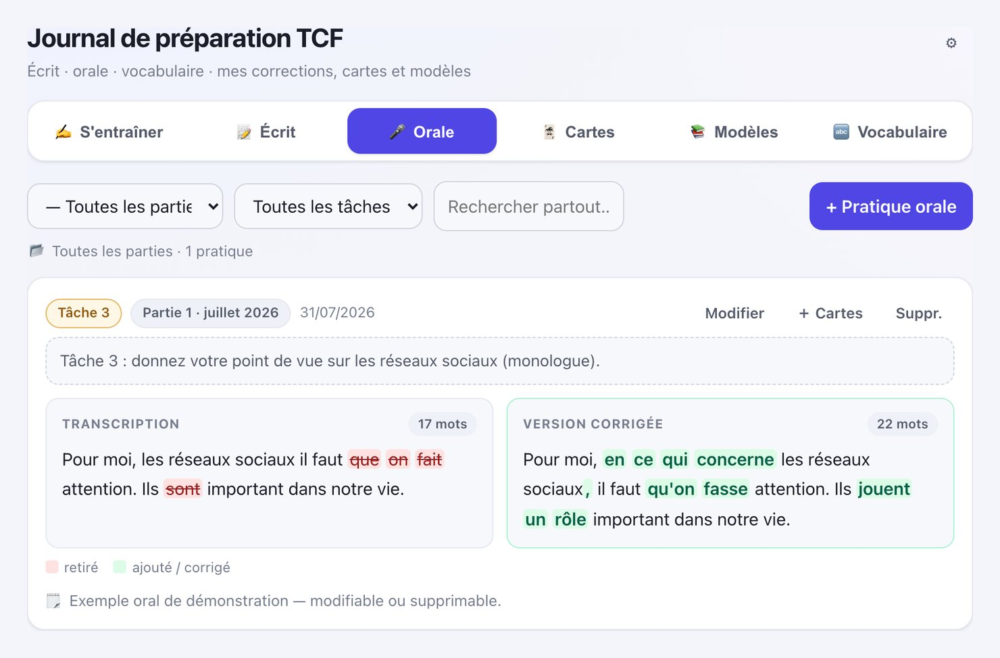
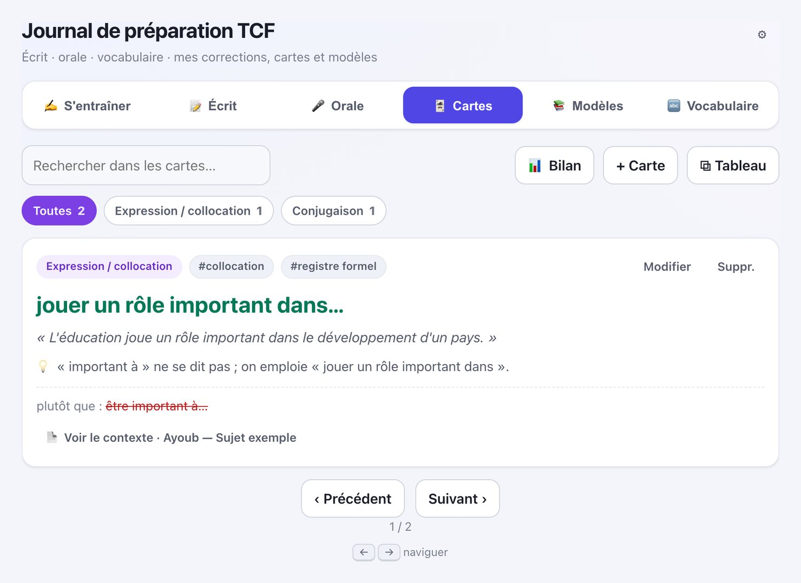
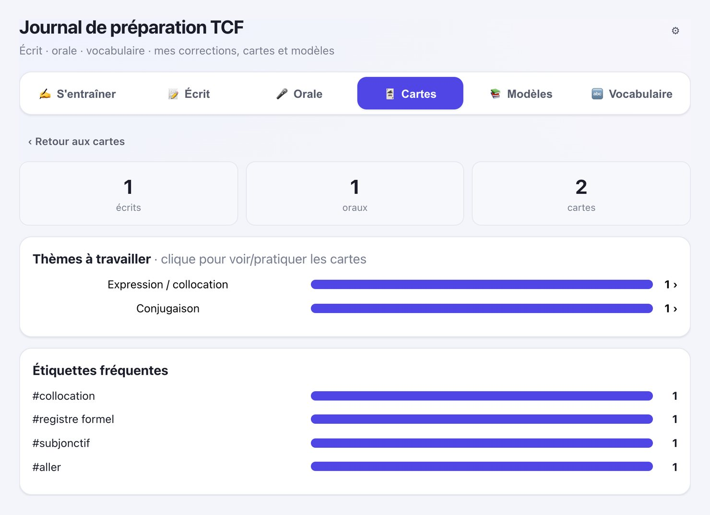
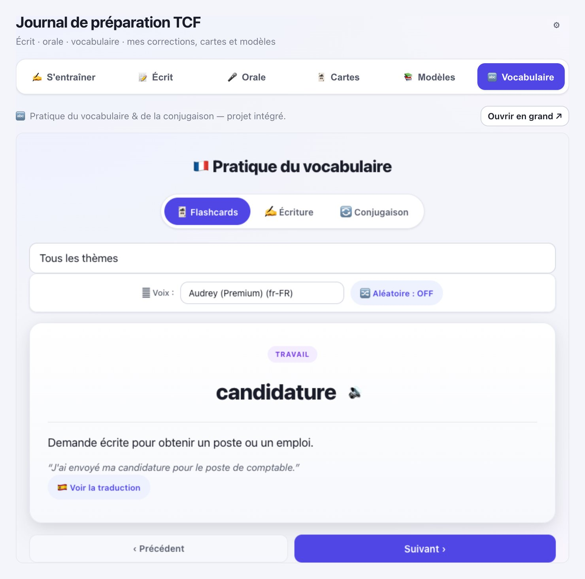

# 🇫🇷 TCF Prep Journal (Journal de préparation TCF)

A personal training platform I built to prepare for the **TCF Canada** French exam: practise writing and speaking under exam conditions, keep every correction in one place, and turn my mistakes into flashcards.

**Live:** [tcf-ecrit-journal.vercel.app](https://tcf-ecrit-journal.vercel.app) *(loads demo data on first visit; your own data stays in your browser)*

## Why I built it

Preparation websites for the TCF have good topics, but they limit how many attempts you get. I wanted to practise as much as I needed **and see whether I was actually improving**.

So I use the topics from those websites and answer them on my own platform. ChatGPT corrects my answers, and the app keeps track of every attempt, every correction and every recurring mistake, so I can study from my own errors instead of starting from zero each time.

I also wanted it to be usable by as many people as possible, so accessibility is part of the goal ([see below](#accessibility-an-ongoing-attempt)).

## How it works

1. **Practise under exam conditions.** Paste a topic, pick the task, and write or speak against the clock. A word counter shows if I'm inside the required range, and spell check is off, like in the real exam.
2. **Get a correction.** One click copies the prompt and my answer. I paste them into ChatGPT together with a standard correction prompt (also one click) that asks for the correction in a fixed table format, an estimated score out of 20 and a CEFR level.
3. **Save it back.** I paste ChatGPT's reply into the app. It shows **my version vs. the corrected version** with every change highlighted, plus a model answer.
4. **Turn errors into flashcards.** Each correction becomes a card (❌ what I wrote → ✅ the correct form, with an explanation and an example), grouped by category: conjugation, collocations, connectors, register…
5. **See what to work on.** The summary shows my average estimated score and the themes where I make the most mistakes, so I know what to practise next.

## Designed to be (almost) free

The platform is deliberately **very cheap to run**:

- It does **not** call an AI API. I use ChatGPT manually with copy and paste, so there's no per-correction cost.
- It's a single static page plus one tiny serverless function, hosted on Vercel's free tier.
- Data is **local-first** (saved in the browser), with optional cloud sync to move between devices. The sync key is derived from a password and hashed (SHA-256) before it leaves the browser.

The trade-off is that corrections aren't instant or automatic, which also makes me read each correction carefully before saving it.

## Screenshots

| Writing: my version vs. corrected | Speaking: transcript vs. corrected |
|---|---|
|  |  |

| Flashcards from my mistakes | Summary: themes to work on |
|---|---|
|  |  |

| Models and templates | Vocabulary practice |
|---|---|
|  |  |

## Features

- **Writing (Expression écrite)** and **speaking (Expression orale)** practice for all three tasks, with countdown or stopwatch (pause, resume, reset)
- Word count with the minimum and maximum for each task
- Side-by-side comparison: my version, the corrected version and a model answer, with highlighted changes
- Estimated score out of 20 and CEFR level per attempt, plus an average over time
- Flashcards generated from corrections, filterable by category and tag, with a link back to the original text
- Reference sheets: model answers, templates, useful expressions, connectors and verb tenses
- Integrated vocabulary and conjugation practice ([tcf-vocab-practice](https://github.com/lfdagm/tcf-vocab-practice))
- Filters by month, task and full-text search; JSON export

## Accessibility: an ongoing attempt

Accessibility is one of the reasons I build my own tools. I treat this as **an attempt, not a claim of full compliance**: what's in place, how I checked it, and what's still missing.

**In place**
- **Keyboard:** everything works with Tab and Enter, in a logical order, with a visible focus ring.
- **Screen readers:**
  - the page is declared in French, so it's pronounced correctly;
  - the navigation is named, and the active section is announced;
  - each section has a heading, so the headings go in order;
  - filters have labels;
  - decorative emoji are hidden;
  - confirmations like "Copié ✔" are read aloud.
- **Contrast:** text meets WCAG 2.1 AA (at least 4.5:1) in both light and dark mode.
- **Comfort:** follows the system's dark mode and respects "reduce motion".
- **One deliberate trade-off:** spell check is turned off in the writing area only, to mirror real exam conditions.

**How I checked it:** an automated [axe-core](https://github.com/dequelabs/axe-core) audit (WCAG 2.1 A/AA plus best practices) on every section in light and dark mode found **0 violations** (November 2026). I also tested keyboard navigation by hand.

**Still to do**
- Testing with people who use screen readers daily (VoiceOver, NVDA); automated tools only catch part of the issues.
- Announcing the timer at key moments (for example, 1 minute left) without being noisy.
- Auditing the embedded vocabulary practice page separately.
- Checking layouts at 200% zoom.

## Tech

- Plain **HTML, CSS and JavaScript** in a single file, with no framework or build step
- **Vercel** for hosting, with a serverless function (`api/data.js`) for the optional sync
- **Redis** (Upstash) for the synced data, via `ioredis`
- Browser `localStorage` as the primary store

Built with AI assistance ([Claude Code](https://claude.com/claude-code)) for the implementation; the learning method, the workflow and the decisions are mine.

## Running locally

Open `index.html` in a browser: everything works locally without a server. The optional cloud sync needs the Vercel function and a `REDIS_URL` environment variable.

---

Made by Luisa Guzman while preparing for the TCF Canada.
